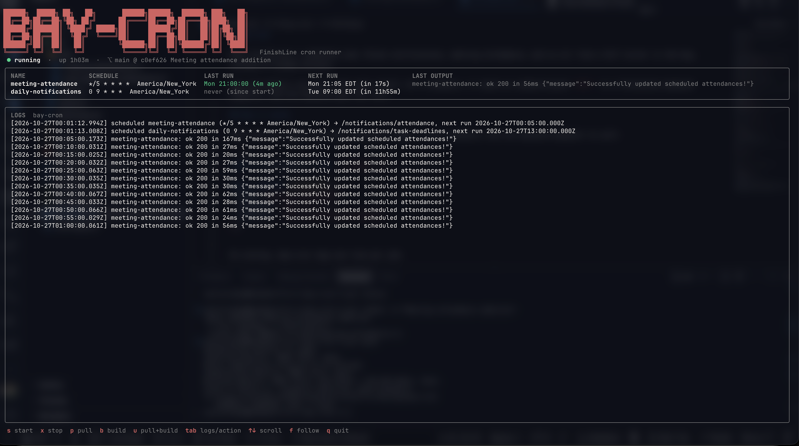

# bay-cron

Runs FinishLine's scheduled jobs (Slack notifications, meeting attendance, and so on) from a 24/7 server in the bay, instead of GitHub Actions.

bay-cron doesn't do any of the work itself. On a schedule, it sends an authenticated `POST` to a FinishLine backend endpoint, and the backend does the rest.

## How it works

Each job is a small file that declares a name, a cron schedule, and the backend endpoint to call:

```ts
import { defineJob } from '../types.js';

export default defineJob({
  name: 'meeting-attendance',
  schedule: '*/5 * * * *',
  endpoint: '/notifications/attendance'
});
```

On startup, bay-cron logs one line per job:

```
[2026-10-26T21:49:37.226Z] scheduled daily-notifications (0 9 * * * America/New_York) → /notifications/task-deadlines, next run 2026-10-27T13:00:00.000Z
```

Schedules are interpreted in the timezone shown on that line (`America/New_York`), so a `0 9 * * *` job fires at 9:00 AM local time year-round, including across daylight saving changes.

Each request sends the shared secret as the raw `Authorization` header value, with no `Bearer` prefix. The backend rejects anything that doesn't match its own `NOTIFICATION_ENDPOINT_SECRET`.

### Adding a job

1. Create a new job file next to the existing ones, following the example above.
2. Optionally, set `timeoutMs` for jobs that can be slow. `daily-notifications` uses 10 minutes, because Slack can be slow.
3. Rebuild: `docker compose up -d --build`.
4. Check that the new job appears in the startup `scheduled` lines: `docker compose logs bay-cron | grep scheduled`.

## Setup

You need Docker with the Compose plugin and a reachable FinishLine backend.

Create a `.env` in the repo root:

```dotenv
BACKEND_URL=http://host.docker.internal:3001
NOTIFICATION_ENDPOINT_SECRET=<must match the backend's NOTIFICATION_ENDPOINT_SECRET>
```

Leave `BACKEND_URL` without a trailing slash. Never commit `.env`.

bay-cron runs in its own container, so `localhost` inside it means the container itself. To reach a backend running on the same machine, use `host.docker.internal`. The compose file maps it to the host with:

```yaml
extra_hosts:
  - 'host.docker.internal:host-gateway'
```

For a remote backend, set `BACKEND_URL` to its real URL.

> **Testing against a local FinishLine?** Every job really runs. Notifications go to whatever Slack channels and users the backend's database points at. Before starting bay-cron, check that team channels point at a test channel and that seeded users don't carry real people's Slack IDs.

## Running it with Docker

All commands are run from the repo root.

| What | Command |
| --- | --- |
| Build and start (or apply changes) | `docker compose up -d --build` |
| Start without rebuilding | `docker compose up -d` |
| Stop | `docker compose stop` |
| Restart | `docker compose restart` |
| Status and restart count | `docker compose ps` |
| Follow logs | `docker compose logs -f bay-cron` |
| Pull latest and redeploy | `git pull --ff-only && docker compose up -d --build` |

The container uses `restart: always`, so it comes back after crashes and reboots. A crash loop shows up as a rising restart count in `docker ps`. Logs are capped at 3 × 10 MB.

### Checking connectivity

Confirm the container can reach the backend:

```sh
docker exec bay-cron sh -c 'wget -qO- "$BACKEND_URL" || curl -s "$BACKEND_URL"'
```

A working backend responds with `"Welcome to FinishLine"`.

### Triggering a job manually

You don't need to wait for the schedule. From the backend's host:

```sh
curl -i -X POST http://localhost:3001/notifications/attendance -H "Authorization: <secret>"
```

| Response | Meaning |
| --- | --- |
| `200` | It worked. |
| `401` | Wrong secret or header format. |
| `403` | The backend's `ADMIN_USER_ID` user lacks an `ADMIN`/`APP_ADMIN` role. |
| `500` | Check the backend's logs. |

## TUI

`bay-cron-tui` is a terminal dashboard that shows:

- The container's state, uptime, restart count, and current commit.
- Every scheduled job, with its schedule, last run, next run, and last output line.
- A live tail of the container's logs.

It also runs the start, stop, pull, and build actions above.

### Building

The TUI is a single Go binary, so the server needs no Go or Node installed. Build it anywhere with Go, cross-compiling for the server:

```sh
cd tui
go mod tidy
GOOS=linux GOARCH=amd64 go build -o bay-cron-tui .
scp bay-cron-tui <server>:~/
```

On the server, optionally put it on your `PATH`:

```sh
sudo mv ~/bay-cron-tui /usr/local/bin/
```

### Running

```sh
bay-cron-tui                                   # defaults: ~/Projects/bay-cron, container "bay-cron"
bay-cron-tui -dir /path/to/bay-cron -container bay-cron -lines 2000
```

Your user needs access to Docker without `sudo`, meaning membership in the `docker` group.

### Keys

| Key | Action |
| --- | --- |
| `s` | Start (`docker compose up -d`) |
| `x` | Stop |
| `p` | Pull (`git pull --ff-only`) |
| `b` | Build and restart (`docker compose up -d --build`) |
| `u` | Pull, then build |
| `tab` | Switch between container logs and action output |
| `↑` / `↓`, `PgUp` / `PgDn` | Scroll |
| `f` | Follow the log again |
| `q` | Quit |

### How it reads jobs

The TUI has no separate config. It reads everything from the container's logs:

- **Name, schedule, and timezone** come from the startup `scheduled …` lines. Next runs are computed from those.
- **Last run** is the most recent log line that mentions a job's name or endpoint. The line is shown in red if it looks like a failure, meaning it contains an error word or a 4xx/5xx status. Include the job name in any log line a job prints so this stays accurate.

Git and SSH prompts are disabled for actions, so a `git pull` that needs credentials fails with an error instead of hanging. Quitting during an action leaves the action running in the background.